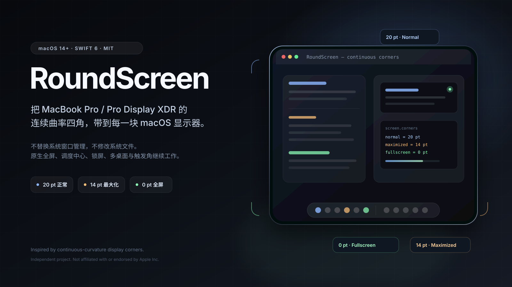

<p align="center">
  
</p>

<h1 align="center">RoundScreen</h1>

<p align="center">
  <strong>Continuous-curvature display corners inspired by MacBook Pro and Pro Display XDR — on every macOS display.</strong><br>
  Native fullscreen, Mission Control, Lock Screen, Spaces, multi-display layouts, and hot corners keep working.
</p>

<p align="center">
  
  
  
  <a href="https://github.com/gnawlrak/RoundScreen/releases"></a>
  <a href="https://github.com/gnawlrak/RoundScreen/actions/workflows/build.yml"></a>
</p>

<p align="center">
  <a href="README.md">简体中文</a> · English
</p>

## What it is

RoundScreen is a macOS menu bar app that draws continuous-curvature corner masks on every display. It is not a wallpaper and does not replace native window management.

The radius follows the current Space:

| State | Default radius | Trigger |
| --- | --- | --- |
| Normal | `20 pt` | No window touches that corner |
| Maximized | `14 pt` | Any window on the display matches the visible frame, or touches that corner |
| Fullscreen | `0 pt` | The frontmost window covers the display, or the frontmost app reports `AXFullScreen` |

The defaults are measured values. Both Normal and Maximized are configurable.

## Highlights

- **Continuous curvature** using three cubic Bézier segments per corner on a fixed `80 pt` canvas.
- **Path-only animation** with `CASpringAnimation`; no moving or resizing overlay windows and no black frames.
- **Smooth `20 pt ↔ 0 pt` transitions**; fullscreen collapses the paths to zero area instead of fading or clearing the layer.
- **Per-display and per-corner resolution**; one display never changes another display's state.
- **Native behavior preserved**; RoundScreen does not replace Dock, Mission Control, Spaces, fullscreen, or Lock Screen.
- **Local only**; no networking code, telemetry, analytics, or remote update mechanism.
- **Pointer exclusion and hot-corner proxy**; optional, requires Accessibility permission.

## Native fullscreen caveat

Many apps report a fullscreen window at `visibleFrame` size rather than the full display frame. RoundScreen therefore reads `AXFullScreen` from the frontmost app as a second fullscreen signal. This is required for apps such as ChatGPT that report `0,33 1470×923` on a `1470×956` display while `AXFullScreen=true`.

## Build

Requirements:

- macOS 14 or newer
- Xcode 16 or newer
- XcodeGen only if you edit `project.yml`

```sh
xcodegen generate
open RoundScreen.xcodeproj
```

Select your own Development Team under **Signing & Capabilities**, then run the `RoundScreen` scheme.

Run the tests:

```sh
xcodebuild -project RoundScreen.xcodeproj -scheme RoundScreen \
  -configuration Debug -derivedDataPath .build/DerivedData \
  -destination 'platform=macOS' test CODE_SIGNING_ALLOWED=NO
```

The repository is source-first. No notarized binary is included; build and sign the app with your own certificate.

## Permissions and limitations

- Accessibility permission is needed for pointer exclusion and for proxying the hot-corner actions configured in Dock preferences.
- Screen Recording permission is not requested.
- Hot-corner actions use Dock private notifications and may change in a future macOS release.
- Some window/Space behavior depends on private SkyLight/WindowServer APIs.
- The pointer clamp is an event-level approximation, not a WindowServer-level hardware cutout.
- Lock-screen timing has been verified with controlled simulations, not an automated real lock.

## Structure

```text
Sources/RoundScreenCore/   Pure geometry, state resolution, path and pointer math
Sources/RoundScreen/        Menu bar app, detection, overlays, lock screen, Accessibility bridge
Tests/RoundScreenCoreTests/
docs/hero.svg
```

## Contributing

See [CONTRIBUTING.md](CONTRIBUTING.md). Report security issues through [GitHub Security Advisories](https://github.com/gnawlrak/RoundScreen/security/advisories/new).

## License

[MIT](LICENSE)

RoundScreen is an independent project and is not affiliated with or endorsed by Apple Inc. MacBook Pro, Pro Display XDR, macOS, and Apple are trademarks of Apple Inc. The project contains no Apple images, icons, or system assets.
