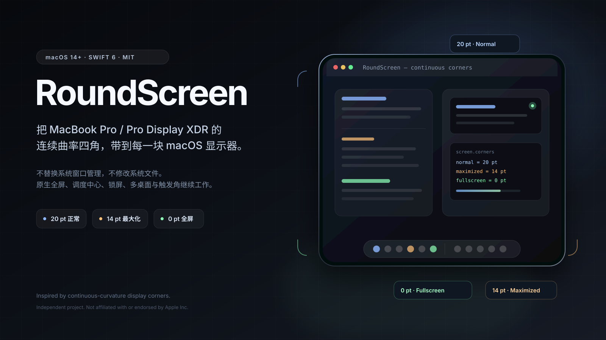

<p align="center">
  
</p>

<h1 align="center">RoundScreen</h1>

<p align="center">
  <strong>把 MacBook Pro / Pro Display XDR 风格的连续曲率四角，带到每一块 macOS 显示器。</strong><br>
  不替换系统窗口管理，不修改系统文件；原生全屏、调度中心、锁屏、多桌面与触发角继续工作。
</p>

<p align="center">
  
  
  
  <a href="https://github.com/gnawlrak/RoundScreen/releases"></a>
  <a href="https://github.com/gnawlrak/RoundScreen/actions/workflows/build.yml"></a>
</p>

<p align="center">
  简体中文 · <a href="README.en.md">English</a>
</p>

## 这不是一张壁纸

macOS 的窗口和显示器默认是直角。换壁纸、改分辨率或安装主题，都不会改变窗口与屏幕交界处的形状。

RoundScreen 在每块显示器上绘制一层真正驻留的四角遮罩：

- 使用 Apple 风格的 continuous 连续曲率控制点，而不是普通圆角矩形；
- 圆角层独立于窗口，不替换 Dock、Mission Control 或系统窗口管理；
- 根据当前 Space 的窗口布局，逐屏、逐角调整半径；
- 默认尺寸来自实机测量：正常 `20 pt`、最大化 `14 pt`、全屏 `0 pt`；
- 遮罩设计为不进入截图和录屏，不读取屏幕内容。

它想解决的不是“给壁纸加个圆角”，而是让每一块 macOS 显示器在视觉上拥有类似 MacBook Pro / Pro Display XDR 的屏幕四角，同时保留系统原有的工作方式。

> RoundScreen 是独立开源项目，与 Apple Inc. 无关联，也未获得 Apple 认可。MacBook Pro、Pro Display XDR、macOS 是 Apple Inc. 的商标。项目不包含 Apple 的图片、图标或系统资源。

## 核心特性

### 连续曲率，不是普通圆角

每个角都在固定的 `80 pt` 画布上用三段贝塞尔曲线绘制“屏幕角外侧月牙”，控制点按 continuous corner 的比例缩放。半径变化时只动画 `CGPath`，窗口本身不移动、不改变大小，因此不会在过渡中露出黑框。

### 三种状态，自动跟随窗口

| 状态 | 默认半径 | 触发条件 |
| --- | --- | --- |
| Normal | `20 pt` | 该角没有窗口贴住 |
| Maximized | `14 pt` | 同屏任一窗口贴合工作区，或窗口对应角贴住屏幕角 |
| Fullscreen | `0 pt` | 最前面的窗口覆盖整屏，或前台应用通过辅助功能报告 `AXFullScreen` |

原生全屏经常不会把窗口边界报告成整屏尺寸。RoundScreen 同时读取辅助功能里的 `AXFullScreen`，避免把“全屏”误判成“最大化”。

### 0 pt 与普通圆角之间也是连续的

全屏时不会先把遮罩淡出或清空路径，而是把四条连续曲率路径弹簧动画到零面积；退出全屏时再从零面积连续展开。`0 pt` 和 `20 pt` 之间没有跳变。

### 每块显示器、每个角独立

RoundScreen 按显示器分别判断当前 Space 的可见窗口：

- 一块显示器的状态不会影响另一块；
- 后台被遮挡的最大化窗口也会把所在显示器锁定为 `14 pt`；
- 一个窗口只贴住左下角时，只有左下角提前降到 `14 pt`；
- Mission Control 打开期间冻结判定，避免缩放后的窗口坐标造成误判。

### 原生系统行为照常工作

- 不修改系统文件，不注入 Dock 或 WindowServer 进程；
- 不替换原生全屏、Spaces、Mission Control 或锁屏；
- 桌面遮罩加入独立的高层级 Space，切换 Space 后继续存在；
- 锁屏使用独立的高层级窗口，并在解锁时平滑交接到桌面层；
- 应用只在本机运行，没有网络代码、遥测或分析 SDK。

## 鼠标排斥与触发角

默认情况下，遮罩本身不接收鼠标和键盘事件。开启辅助功能权限后，RoundScreen 会：

1. 在鼠标或拖拽事件进入四角月牙前，把光标夹到连续曲率曲线内侧；
2. 在约 `60 Hz` 的定时检查中兜住事件 tap 漏掉的末端事件；
3. 读取 `com.apple.dock` 的 `wvous-*-corner` 和修饰键配置；
4. 鼠标在圆角附近连续停留约 `0.7 s` 后，执行系统设置的同一项触发角动作。

触发一次后会锁存，必须先离开内曲线约 `10 pt` 才能再次触发。快速划过会取消待执行动作。

> 鼠标排斥和触发角代理需要“系统设置 → 隐私与安全性 → 辅助功能”权限。未授权时圆角仍会绘制，但鼠标可以进入缺口，触发角代理也不会运行。

## 安装与构建

### 从源码运行

环境要求：

- macOS 14 或更新版本；
- Xcode 16 或更新版本；
- 可选：XcodeGen，仅在修改 `project.yml` 后需要。

```sh
xcodegen generate
open RoundScreen.xcodeproj
```

在 Xcode 的 **Signing & Capabilities** 中选择你自己的 Development Team，然后运行 `RoundScreen` scheme。

首次启动后，在菜单栏打开 RoundScreen 设置，按提示授予辅助功能权限。若要使用 Release 版本并保留权限身份，请使用固定签名，不要反复切换 ad-hoc 签名。

### 命令行测试

```sh
xcodebuild -project RoundScreen.xcodeproj -scheme RoundScreen \
  -configuration Debug -derivedDataPath .build/DerivedData \
  -destination 'platform=macOS' test CODE_SIGNING_ALLOWED=NO
```

### Release 构建

```sh
xcodebuild -project RoundScreen.xcodeproj -scheme RoundScreen \
  -configuration Release -derivedDataPath .build/ReleaseDerived \
  -destination 'platform=macOS' SYMROOT=build build
open build/Release/RoundScreen.app
```

仓库当前以源码形式发布，不附带 notarized 二进制。Release 构建需要你自己的 Apple Development 证书；从源码构建的应用需要自行签名和授权。

## 项目结构

```text
Sources/
  RoundScreenCore/      # 纯几何、状态解析、路径和鼠标曲线，可单元测试
  RoundScreen/          # 菜单栏应用、窗口检测、遮罩、锁屏和辅助功能桥接
Tests/
  RoundScreenCoreTests/ # 28 个核心单元测试
docs/
  hero.svg              # README 封面
```

关键入口：

- `Sources/RoundScreenCore/DisplayStateResolver.swift`：把窗口快照映射为每屏/每角状态；
- `Sources/RoundScreenCore/CornerMaskPathBuilder.swift`：continuous 曲率路径；
- `Sources/RoundScreen/Overlay/CornerOverlayView.swift`：路径弹簧动画；
- `Sources/RoundScreen/Overlay/OverlayCoordinator.swift`：桌面层、锁屏层和窗口显隐时序；
- `Sources/RoundScreen/Detection/NativeFullscreenProvider.swift`：`AXFullScreen` 原生全屏检测；
- `Sources/RoundScreen/Overlay/CornerCursorGuard.swift`：鼠标排斥与触发角代理。

## 已知边界

- 完全铺满整屏的无边框窗口会被当作 Fullscreen；少数按整屏而非工作区铺满的窗口也会收拢到 `0 pt`。
- 当前是“每角独立 + 最大化窗口全角生效”的折中，不是逐边独立。
- 锁屏逻辑通过可控模拟验证了上屏/撤下时序，但没有自动执行真实锁屏，以免中断当前会话。
- 触发角动作依赖 Dock 的私有通知和系统应用/服务，不保证未来 macOS 版本仍保持相同动作编号。
- 遮罩不进入截图和录屏；鼠标限制通过公开事件拦截与光标校正实现，不能等同于 WindowServer 对硬件屏幕形状的裁切。
- 部分能力使用 macOS 私有 SkyLight/WindowServer 接口，未来系统版本可能变化。

## 实测记录

- 28 个核心单元测试通过。
- ChatGPT 原生全屏：`AXFullScreen=true`，但 WindowServer 边界仍为 `visibleFrame`（`0,33 1470×923`，不是整屏 `1470×956`）；接入 `AXFullScreen` 后可正确进入 Fullscreen。
- 进入全屏时桌面遮罩保持 `alpha=1`，抓到的 `CASpringAnimation` 路径从 `14×14` 连续插值到 `0×0`；不再通过隐藏窗口或清空 `CGPath` 实现 `0 pt`。
- 授权辅助功能后，系统事件 tap 列表中存在启用的 RoundScreen 鼠标 tap；四角快速移动和直接 warp 都会被夹回曲线内侧。
- 触发角代理实测可打开调度中心、启动屏幕保护程序；测试后已恢复 Dock 原有触发角设置。

## 参与贡献

欢迎提交 issue 和 pull request。请先阅读 [CONTRIBUTING.md](CONTRIBUTING.md)，并确保测试通过、没有提交构建产物或个人签名配置。

安全问题请通过 [GitHub Security Advisories](https://github.com/gnawlrak/RoundScreen/security/advisories/new) 私下报告，不要公开包含凭据的 issue。

## License

[MIT](LICENSE)

RoundScreen 是独立项目，不隶属于 Apple Inc.，也不代表 Apple 的官方设计或实现。Apple、MacBook Pro、Pro Display XDR 和 macOS 是其各自权利人的商标。
